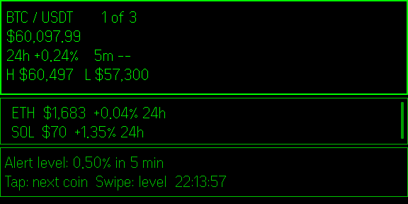

# Binance Glance

A one-screen crypto watchlist for the **Even Realities G2** smart glasses,
built for the Heads Up: Even Realities Hackathon (track: **Exchanges &
Stocks** — Binance).



_The G2 framebuffer (576×288) captured from the official simulator: the
focused coin large on top, the rest of the watchlist below, and the alert
level plus gesture hints in the status bar._

## The problem

Crypto holders check prices dozens of times a day by pulling out a phone,
unlocking it, and opening an exchange app — a 15-second ritual for a
one-second question: "what is BTC doing right now?" For anyone who holds a
small portfolio and just wants to stay aware (a sudden 1% move in five
minutes is worth knowing about; the full order book is not), the phone is
heavyweight and distracting.

## Who it is for

Retail crypto holders who wear (or will wear) Even G2 glasses and keep a
small watchlist — here BTC, ETH, and SOL against USDT. They want awareness,
not a trading terminal.

## How it works

Binance Glance is an Even Hub web app (TypeScript + Vite) that draws one
glanceable screen through the official `@evenrealities/even_hub_sdk`:

- **One screen, three containers** on the 576×288 G2 canvas: the focused
  coin large (price, 24h change, 5-minute move, 24h high/low), the other
  two coins as one-line rows, and a status bar with the alert level.
- **Live read-only data** from Binance's public REST API
  (`/api/v3/ticker/24hr`), refreshed every 15 seconds. It uses
  `data-api.binance.vision` — Binance's market-data-only public host —
  first, with `api.binance.com` as a fallback (the classic host returns
  HTTP 451 from some regions; the data host does not).
- **Read and act in seconds**, matching the G2 interaction model:
  - **Tap** (temple or R1 ring) — cycle the focused coin.
  - **Swipe up / down** — raise or lower the move-alert level in 0.10%
    steps (0.10%–5.00%).
  - **Double tap** — exit through the system confirmation dialog
    (`shutDownPageContainer(1)`, as required on a root page).
- **Move alerts**: the app keeps a rolling 5-minute price window per coin.
  When a coin moves at or beyond the alert level inside that window, the
  status bar switches to a bright `** ALERT: SOL +1.32% **` state and the
  coin's row is flagged — visible in a single glance, no phone needed.
- **Web preview fallback**: opened in a plain browser (no SDK bridge), the
  same screen renders as a DOM mirror with buttons that mirror the
  gestures, running on the same live data. Useful for demos and review.

## Safety and track compliance

- **Read-only.** Market data only — the app calls one public `GET`
  endpoint. No API key, no account, no login.
- **No user funds.** Nothing is held, moved, or tradable; there is no
  order functionality of any kind.
- **No financial advice.** The app displays prices and user-set movement
  thresholds only. It never recommends buying, selling, or holding.
- Only Binance (a listed Exchanges & Stocks service) is integrated.

## Setup and run

Prerequisites: Node.js 20+ (the Even Hub CLI wants 20.17+/22.13+/23.5+).

```bash
npm install
```

Run in the official simulator (two terminals):

```bash
# Terminal 1 — dev server
npm run dev

# Terminal 2 — simulator pointed at the dev server
npx evenhub-simulator http://localhost:5173
```

The simulator window shows the glasses canvas next to the phone-side
webview. Use its **Up / Down / Click / Double Click** controls to drive
the app. Headless driving is also available via the simulator's
automation API (`--automation-port 9898`, then `POST /api/input`).

Production build and packaging:

```bash
npm run build                       # type-check + Vite build into dist/
npx evenhub pack app.json dist -o binance-glance.ehpk
```

Run on real glasses (optional): serve the dev build on your LAN and use
`npx evenhub qr --url "http://<your-lan-ip>:5173"`, then scan the QR code
from the Even Realities phone app (requires an Even Realities account with
Developer Mode enabled).

## Features

- Live BTC/ETH/SOL watchlist from Binance public data, 15 s refresh.
- Focus view with price, 24h change, 5-minute move, 24h high/low.
- Tap to cycle coins; swipe to set the alert level (0.10% steps).
- 5-minute rolling-window move alerts with a high-brightness alert state.
- High-contrast monochrome layout designed for the 576×288 G2 display:
  one idea per container, a few words per line.
- Graceful degradation: endpoint fallback (data host → classic host),
  last-good prices kept on screen if an update fails, and a full web
  preview mode when no glasses bridge is present.
- Packaged `.ehpk` builds cleanly with the official CLI.

## Project structure

```
app.json            Even Hub manifest (network whitelist: Binance hosts only)
index.html          Web entry + web-preview mirror of the glasses screen
src/main.ts         Glasses UI (SDK containers), gestures, render loop
src/market.ts       Binance data layer + alert math (pure, unit-testable)
public/icon.png     24×24 greyscale app icon
docs/               Simulator framebuffer captures (RGBA + flattened)
binance-glance.ehpk Packaged app (optional deliverable)
```

## Verification performed

- `npm run build` — TypeScript + Vite production build, clean.
- Data layer exercised in Node against the live Binance API: quotes for
  all three pairs returned; alert math verified (flat series → no alert,
  +1.2% jump → alert at 0.50% level, no alert at 2.00%; insufficient
  history → no alert).
- Official simulator (v0.9.5) under a virtual display: app booted, SDK
  bridge connected, all three containers rendered with live prices;
  framebuffer captured via `GET /api/screenshot/glasses` (9,329 lit
  pixels, see `docs/`).
- Gestures driven through the simulator automation API: `click` cycled
  BTC → ETH, `up` raised the alert level 0.50% → 0.60%, and
  `double_click` reached the app as `DOUBLE_CLICK_EVENT` and closed the
  page through the system exit path. The simulator console showed no
  errors and no failed fetches during the runs.
- `evenhub pack` produced `binance-glance.ehpk` (36,940 bytes, no
  warnings, `min_app_version` 2.2.10).

## API feature requests

For the Even Hub platform team:

1. **Built-in speech-to-text for the G2 microphone.** The SDK exposes raw
   PCM capture, but turning voice into commands requires an external ASR
   service. For track-restricted apps (financial tracks may only use
   listed services) there is currently no compliant way to add voice
   control. A first-party `bridge.speechToText()` would unlock the
   voice-first interactions the G2 is designed for.
2. **One documented tap payload.** A temple tap reached our handler in
   two different shapes depending on the host: as a `textEvent`, and as a
   bare `sysEvent` carrying only `eventSource` (protobuf `CLICK_EVENT`
   = 0 serialized away). A single normalized click event, guaranteed
   across simulator and hardware, would remove fragile guesswork from
   every app's input handler.
3. **A cheaper alert primitive.** Drawing attention today means rewriting
   text content or rebuilding the page. A container-level "flash/invert
   border" call would make glanceable alerts (our core feature) cheaper
   and less flickery.
4. **A large-text container type.** The firmware font is fixed-size, so a
   hero number (a price) can only be made prominent with empty space. A
   double-height text container for one or two lines would materially
   improve glanceability for data apps.
5. **Simulator window input under synthetic clicks.** In a headless Xvfb
   session, the on-screen Up/Down/Click buttons did not react to
   synthetic mouse clicks (the HTTP automation API worked perfectly).
   Making the window controls respond to standard X11 synthetic events
   would help CI setups that cannot use the automation port.

For Binance:

6. **A longevity note for `data-api.binance.vision`.** It is the only
   Binance host reachable from regions where `api.binance.com` returns
   HTTP 451, which makes it the de-facto public-data API for
   read-only apps like this one. Documenting it as a stable, supported
   surface (with its CORS `*` behavior, which the Even Hub WebView
   requires) would let developers rely on it with confidence.

## Notes

- Built during the hackathon build week (23–29 Nov 2026) using the
  official Even Hub SDK (0.0.16), CLI, and simulator, plus the Binance
  public API — all pre-existing, documented in this README as required.
- No real G2 hardware was used; all verification ran on the official
  simulator, which the hackathon explicitly allows.
